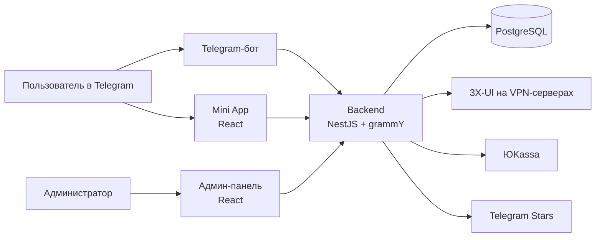

# VPN Bot

Telegram-бот, мини-приложение и админ-панель для продажи подписок на VPN (VLESS + Reality).
Пользователь выбирает тариф прямо в Telegram, оплачивает его звёздами Telegram или картой через ЮKassa
и сразу получает ключ подключения с QR-кодом. Ключи выдаются автоматически через панель 3X-UI на VPN-серверах.

## Возможности

**Для пользователя**
- покупка и продление подписки в боте или в Telegram Mini App;
- оплата через Telegram Stars или банковской картой (ЮKassa);
- ключ подключения и QR-код, статистика трафика, смена сервера;
- промокоды, реферальная программа с бонусными днями;
- обращения в поддержку прямо из мини-приложения.

**Для администратора** (отдельная веб-панель)
- дашборд: выручка, рост пользователей, подписки, воронка конверсии;
- управление пользователями, подписками, тарифами и серверами;
- промокоды и персональные скидки, в том числе массовые;
- рассылки и публикации в канал, ответы на обращения;
- журнал действий администраторов, вход с двухфакторной аутентификацией, выгрузка в Excel.

**Автоматизация** (фоновые задачи)
- отключение истёкших подписок и синхронизация трафика с серверами;
- напоминания об окончании подписки и о превышении трафика;
- проверка доступности серверов;
- предложения со скидкой для пробных пользователей и возврат ушедших.

## Архитектура



- **Mini App** авторизуется через подпись `initData` Telegram, которую проверяет backend.
- **Админ-панель** использует JWT, вход ограничен по частоте запросов и защищён 2FA.
- **Вебхук ЮKassa** принимается только с IP-адресов ЮKassa.

## Стек

| Часть | Технологии |
|---|---|
| Backend | NestJS 11, TypeScript, grammY, TypeORM, PostgreSQL 16, `@nestjs/schedule` |
| Mini App | React 19, Vite, Tailwind CSS, Zustand, React Router |
| Админ-панель | React 19, Vite, Tailwind CSS, Zustand, Recharts |
| Инфраструктура | Docker Compose, PM2, Nginx, GitHub Actions (сборка и деплой) |

## Структура репозитория

```
backend/    API и Telegram-бот (NestJS)
  src/
    bot/           команды бота, клавиатуры, оплата звёздами
    subscription/  API для мини-приложения
    payment/       платежи и вебхук ЮKassa
    vpn/           работа с панелью 3X-UI
    admin/         API админ-панели
    shared/cron/   фоновые задачи
  migrations/      миграции базы данных
mini-app/   Telegram Mini App
admin/      админ-панель
.github/workflows/deploy.yml   сборка и деплой при пуше в main
```

## Запуск локально

Нужны Node.js 20+, Docker и тестовый бот от [@BotFather](https://t.me/BotFather).

```bash
# 1. Переменные окружения: заполнить .env, его читают и Docker Compose, и backend
cp backend/.env.example .env
cp .env backend/.env

# 2. База данных
docker compose up -d postgres

# 3. Backend
cd backend
npm ci
npm run migration:run
npm run start:dev

# 4. Mini App и админ-панель (в отдельных терминалах)
cd mini-app && npm ci && npm run dev
cd admin && npm ci && npm run dev
```

Без `YOKASSA_SHOP_ID` и `YOKASSA_SECRET_KEY` оплата картой отключается, оплата звёздами продолжает работать.
Без `WEBHOOK_DOMAIN` бот работает в режиме long polling.
